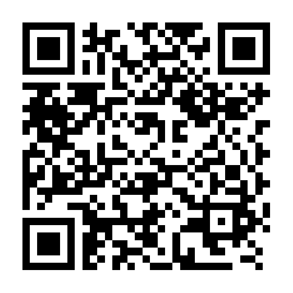
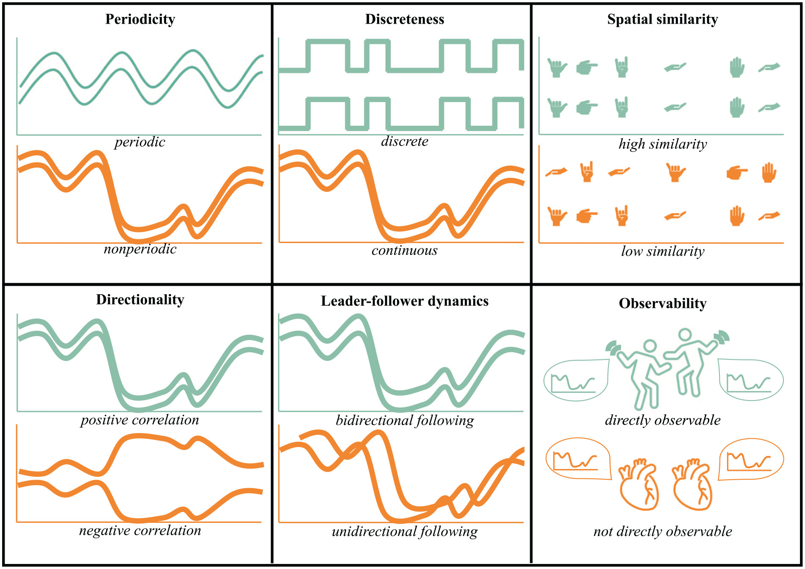
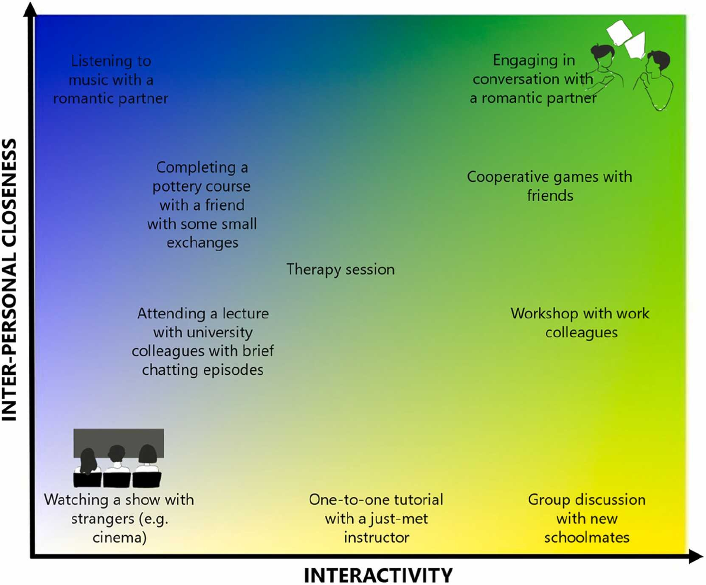
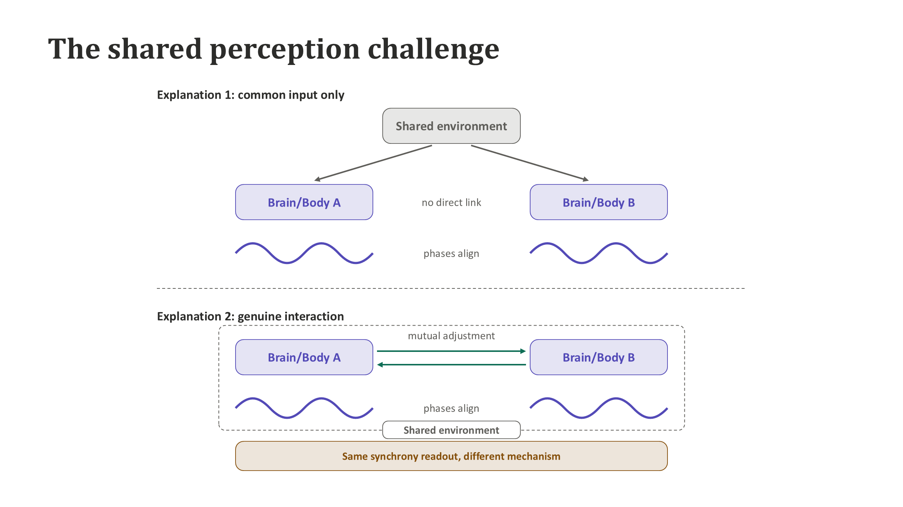
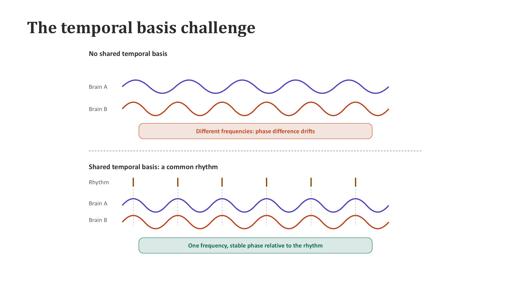
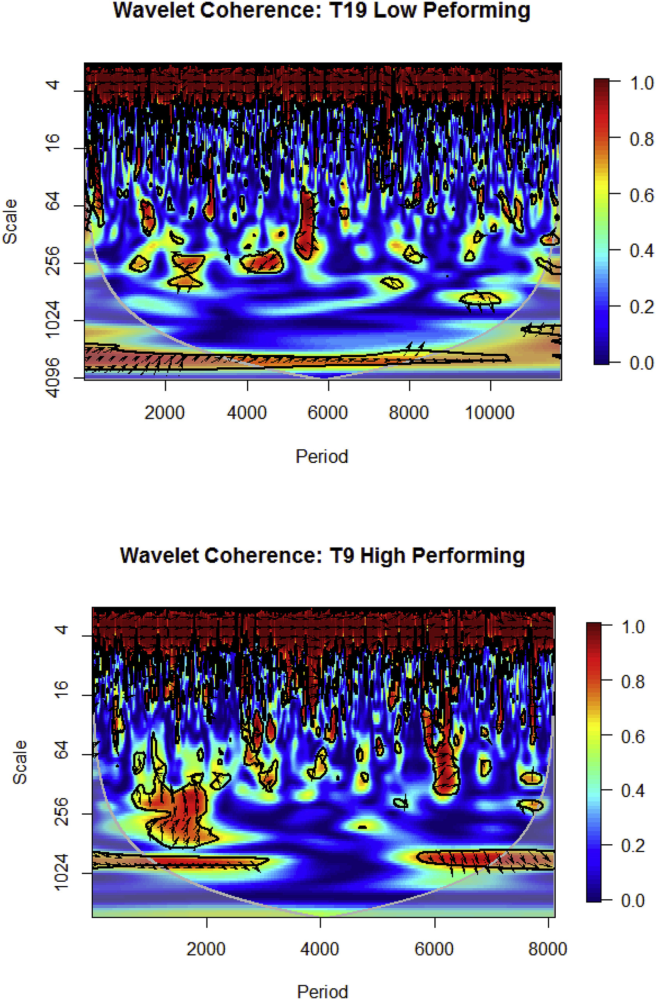
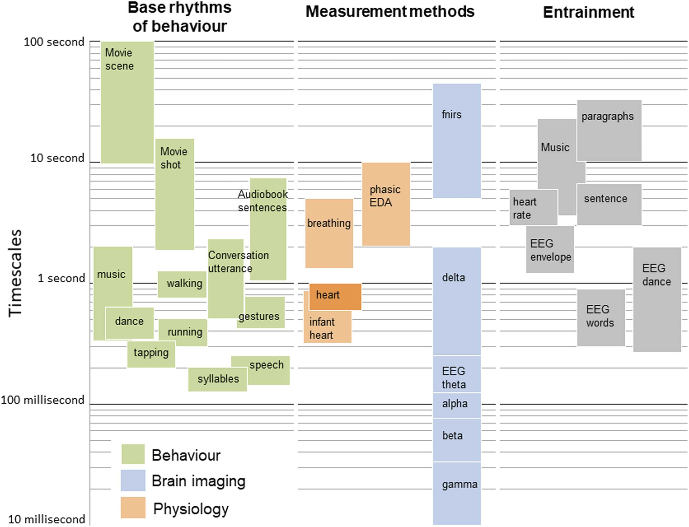

```{=html}
<!-- Speaker notes (press S) 
     no ### headings inside ::: activity boxes;
     use [Label]{.activity-title}. Dividers are ## slides with .navy, not #. -->
```

## Welcome {.smaller}

:::: {.columns}
::: {.column width="60%"}
- **Wim Pouw**, Tilburg University, Dept. of Computational Cognitive Science
- **Travis J. Wiltshire**, Tilburg University, Dept. of Computational Cognitive Science
- 90 minutes: short talk, a shared listening experience, **two breakout groups**, and a joint discussion
- You do **not** need to know signal processing or neuroscience: bring your own field's perspective
:::

::: {.column width="40%"}
Slides and materials:

<https://travisjwiltshire.github.io/MPI.EA.synchrony.workshop.2026/>

{fig-align="center" width="260"}

<p class="small">Repository: <https://github.com/travisjwiltshire/MPI.EA.synchrony.workshop.2026></p>
:::
::::

::: notes
0:00-0:03. Quick round: ask people to say their discipline in one word (musicology, psychology, neuroscience, sociology, literature...), so groups can be mixed later.
:::

## Today, 14:00-15:30 {.smaller .tight}

| Time | Block | Mode |
|------------------------|------------------------|------------------------|
| 14:00 | Welcome, goals, ground rules | Talk |
| 14:05 | Primer: what is synchrony, and why is it tricky? | Talk |
| 14:17 | **Shared listening experience** | All together |
| 14:22 | Form groups, brief instructions | Plenary |
| 14:25 | **Breakouts**: *Conceptualization* and *Operationalization* | Two groups |
| 14:55 | **Reconvene**: group reports and integration | Plenary |
| 15:20 | Wrap-up: open questions, next steps | Plenary |
| 15:30 | End | |


## Workshop Goals and ground rules

**By the end of this workshop we would like to:**

1.  **Articulate** what "genuine" interpersonal synchrony might mean, beyond two or more people perceiving the same things in a shared environment
2.  **Sketch** how synchrony could be both an *effect* and a *cause* of shared experience
3.  **Identify** designs and analyses that could tell these accounts apart
4.  **Leave** with new ideas, open questions, and possible collaborations

**Ground rules:** no "wrong" disciplines, no jargon without explanation (ask!), disagreement is useful, we are *sketching*, not solving.

## The problem domain {.navy background-color="#1B3668"}

## What is interpersonal (Neuro)physiological synchrony? 

- The temporal coupling of activity between two or more people, which can have different forms.

{fig-alt="daSilva & Wood, 2025" fig-align="center" width="85%"}

## Synchrony also occurs at different levels  {.smaller}


| Level | Signals | Typical methods |
|------------------------|------------------------|------------------------|
| **Interbrain** | Neural activity | EEG / fNIRS *hyperscanning* |
| **Interpersonal physiology** | Heart rate, electrodermal activity, respiration | Wearable sensors |
| **Behavior** | Movement, vocalization | Motion capture, video, audio |


## Synchrony is widely used as an indicator of social connections or relationship quality

- Widely used as an index of **social connection**, rapport, and shared engagement
- Shared experiences, such as **live music, film, or dance**, are a natural test case


## Why music? {.smaller}

- Music is **temporally structured**: it supplies beat, meter, and phrasing that bodies and brains can track and engage with
- Music is often experienced **together**: concerts, clubs, choirs, rituals
- This makes it an ideal place to ask: *is synchrony a sign of being together, how well you are connected to someone, or just about hearing/seeing the same thing?*


## Interpersonal closeness vs level of interactivity 

{fig-alt="De Felice et al., 2025" fig-align="center" width="85%"}


## The central question

:::: {.columns}
::: {.column width="50%"}
**Explanation 1: shared environment**

Two people synchronize simply because they are **exposed to the same information in a shared environment** (shared information-driven entrainment).
:::

::: {.column width="50%"}
**Explanation 2: genuine coupling**

There is **interpersonal coupling** that goes beyond mere shared information-driven entrainment.
:::
::::

**But what would count as *genuine* coupling?**

If someone claps in front of you and you both lock onto that rhythm, is that trivial, or is it exactly what interaction is?

## The shared perception challenge

{fig-alt="Diagram contrasting common input only with genuine interaction. Both yield aligned phases." fig-align="center" width="85%"}

::: notes
The same synchrony estimates can arise from different mechanisms. In Explanation 2 the shared environment is still there; what differs is the mutual adjustment between the two systems. This is the point we want groups to deliberate on.
:::

## The temporal basis challenge

{fig-alt="Two oscillators with different frequencies drift in phase; with a common rhythm they hold a stable phase relative to it." fig-align="center" width="85%"}

::: notes
Synchrony requires a shared temporal basis. Without a common rhythm, phases drift. A shared rhythm (e.g., music) provides that basis, which is why music is both a great test case and a confound.
:::

## A theoretical paradox {.smaller}

Many accounts say synchrony **causes** aspects of social interaction (e.g., empathy, alliance). Others treat it as a **result** of interaction.

- For something to be a **cause**, it must be separable from what it causes (no thing causes itself)
- So synchrony would need to be something *over and above* the social interaction
- Yet synchrony seems impossible to understand **without** the interaction through which it arises

**How can synchrony cause the very thing it cannot be separated from?**


<p class="small">

Following the general paradox discussed in Juarrero (2023), *Context Changes Everything*.

</p>


## What changes when we co-experience? {.smaller}

What differs between **two people independently hearing the same audio** and **a shared listening experience**?

- **Presence**: being in the same space
- **Social context**: who the other person is, our relationship, shared history, culture, etc.
- **Mutual awareness** of the other's engagement

These plausibly change the **processing itself**, not only the output measures. But *how*, and does it matter for how we measure synchrony?

## Shared listening experience {.navy background-color="#1B3668"}

## Let's listen together {.smaller}

::: activity
[Whole room · 5 min]{.activity-title}

1.  **Listen** together to the video: <https://youtu.be/HOe4k1V5uCY>, seated so we can sense each other in the room
2.  **Notice** (silently): body (breathing, heartbeat, tapping), attention, and awareness of others
3.  **Write down** a few words about what it felt like **as a shared listening experience** and if the experience gave any intuitions about intepersonal (neuro)physiological synchrony
:::

## Shared listening: the video {.center}

<iframe data-src="https://www.youtube.com/watch?v=HOe4k1V5uCY&t=42s" width="100%" height="500" style="border:none;" allow="autoplay; encrypted-media; fullscreen" allowfullscreen loading="lazy">

</iframe>

<p class="small" style="margin-top:0;">

Backup link: <https://www.youtube.com/watch?v=HOe4k1V5uCY&t=42s>

</p>


## Form breakout groups {.smaller}

Let's form two mixed background groups, roughly equal size.

| Group | Focus | Starting point |
|------------------------|------------------------|------------------------|
| **Group 1** | Conceptualization | *What is genuine synchrony, and how can it be a cause and an effect?* |
| **Group 2** | Operationalization | *How would we measure and test synchrony and understand it's meaning?* |

**Roles** within each group: facilitator (Wim & Travis), note-taker (writes short bullets, summary), reporter (speaks for 5 min).

## Breakout groups {.navy background-color="#1B3668"}

## Group 1: Conceptualization (Wim) {.smaller}

::: activity
[30 min · discuss, write down a few points{.activity-title}

**Synchrony as both cause and effect.** It emerges from shared information processing; under what conditions does it feed back and become a cause of subsequent shared experience or behavior?

1.  **Define** (10 min): what would it mean for synchrony to be *genuine*? Is there a role for the shared stimulus within it?
2.  **Framework** (10 min): what theoretical account would be needed (e.g., a feedback loop between stimulus-driven and socially modulated coupling)? What **constraints** does it need?
3.  **Falsify** (7 min): what would **falsify a purely epiphenomenal account**?
4.  **Pick takeaways** (3 min): 3-5 bullets you will say aloud in 5 minutes
:::

::: notes
Prompts if stuck: 

:::

## Group 2: Operationalization (Travis) {.smaller}

::: activity
[30 min · discuss & write a few points]{.activity-title}

**Measure synchrony in a way that addresses the temporal basis and/or shared perception challenge.**

1.  **Separate** (10 min): how would you disentangle synchrony driven by the **shared perception** from synchrony driven by the **shared social context**? (e.g., same audio, alone vs. together)
2.  **Show it matters** (10 min): what design or analysis would mechanistically demonstrate that  synchrony matters (e.g., **systemtically relates to an outcome** (memory, affect, rapport, coordination) rather than merely co-occurring with it?
3.  **Control/Baseline Comparisons** (7 min): what null or control comparison would you use? What would the data look like if there were no genuine coupling?
4.  **Pick takeaways** (3 min): 3-5 bullets you will say aloud in 5 minutes
:::

::: notes
Pointers if stuck: surrogate/shuffled pairings (pairs who never met), time-lagged controls, manipulation of mutual awareness, stimulus-removed (residual) coupling, multibrain stimulation (Novembre & Iannetti, 2021), time-varying or multiscale measures (see appendix). 
:::

## Capturing the discussion {.smaller}

The note-taker writes **short statements or bullets** under three headings:

| Heading | What to write |
|------------------------|------------------------------------------------|
| **Key points** | 2-4 statements we mostly agree on |
| **Disagreements** | Where we split, in a few words |
| **Open questions** | What we could not resolve |

Sketches, arrows, and half-sentences are fine. We will collect the notes after the workshop.

## Reconvene {.navy background-color="#1B3668"}

## Group reports {.smaller}

::: activity
[Plenary · 5 min per group]{.activity-title}

- **Group 1** (conceptual starting point)
- **Group 2** (operational starting point)
- Reporters speak from their bullets; no slides needed
- Audience: write down one thing you **agree** with and one thing you **would challenge**
:::

## Integration {.smaller}

::: activity
[Plenary · about 12 min]{.activity-title}

1.  **Converge or conflict?** (4 min): where do the two framings agree, and where do they pull apart?
2.  **What would a study need?** (4 min): what must it include to have **both a conceptual account of causality and an operational way to test it**?
3.  **Back to the listening** (2 min): what did you write down after the collective listening experience and would a synchrony measure capture it, and what would it miss?
4.  **Record** (2 min): 3-5 shared takeaways
:::


## Wrap-up {.smaller}

- **Open questions**: what did we not resolve?
- **Next steps**: how might we take this forward (short position paper? joint design? shared data?)
- **Collaborations**: who is interested in continuing the conversation?

Contact: 
- Wim Pouw 

- Travis J. Wiltshire

[t.j.wiltshire\@tilburguniversity.edu](mailto:t.j.wiltshire@tilburguniversity.edu)


[\@tjwiltshire.bsky.social](https://bsky.app/profile/tjwiltshire.bsky.social))


## Appendix: measuring synchrony {.navy background-color="#1B3668"}

## Glossary for non-specialists {.smaller}

| Term | Plain-language meaning |
|------------------------|------------------------------------------------|
| **Hyperscanning** | Recording brain activity (EEG, fNIRS) from two or more people at once |
| **Entrainment** | A system's rhythm becoming aligned to an external rhythm (e.g., a beat) |
| **Phase** | Where a signal is in its cycle (peak, trough, between) |
| **Phase locking** | Two signals keeping a stable phase relationship over time |
| **Coupling** | Two systems influencing each other over time |
| **Epiphenomenon** | Something that accompanies a process without causing anything |
| **Surrogate data** | Shuffled or re-paired data used to ask how much synchrony chance alone would give |

## Coordination is time-varying and multiscale {.smaller}

:::: {.columns}
::: {.column width="50%"}
- Coordination is **not constant**: it rises and falls over a session
- It occurs at **multiple timescales** (fast to slow)
- Averages (mean correlation, one coherence number) can hide **when** and **at which scale** it occurs
- Examples: movement rhythms linked to **rapport** (Fujiwara et al., 2020); coordination at specific timescales predicted team problem-solving (Wiltshire et al., 2019)
:::

::: {.column width="50%"}
{fig-alt="Wavelet coherence of teams over time and scale"}
:::
::::

## Timescales of synchrony in brain and behavior

{fig-align="center" width="80%"}


## References {.smaller .scrollable}

::: {.small .refs}
daSilva, E. B., & Wood, A. (2025). How and why people synchronize: An integrated perspective. *Personality and Social Psychology Review, 29*(2), 159-187.'

De Felice, S., Chand, T., Croy, I., Engert, V., Goldstein, P., Holroyd, C. B., ... & Vrticka, P. (2025). Relational neuroscience: Insights from hyperscanning research. *Neuroscience & Biobehavioral Reviews, 169*, 105979.

Fujiwara, K., Kimura, M., & Daibo, I. (2020). Rhythmic features of movement synchrony for bonding individuals in dyadic interaction. *Journal of Nonverbal Behavior, 44*(1), 173-193.Fujiwara et al., 2020.

Hamilton, A. (2021). Hyperscanning: beyond the hype. *Neuron, 109*(3), 404-407.

Hamilton, A., Southgate, V., Miskowiak, K., Bjertrup, A. J., Lomoriello, A. S., De Felice, S., ... & Konvalinka, I. (2026). Rhythms of interaction: the timescales of social coordination and why they matter. *Neuroscience & Biobehavioral Reviews*, 106827.

Juarrero, A. (2023). *Context changes everything: How constraints create coherence*. MIT Press.

Le Van Quyen, M., Foucher, J., Lachaux, J. P., Rodriguez, E., Lutz, A., Martinerie, J., & Varela, F. J. (2001). Comparison of Hilbert transform and wavelet methods for the analysis of neuronal synchrony. *Journal of Neuroscience Methods, 111*(2), 83-98.

Likens, A. D., & Wiltshire, T. J. (2021). Windowed multiscale synchrony: Modeling time-varying and scale-localized interpersonal coordination dynamics. *Social Cognitive and Affective Neuroscience, 16*(1-2), 232-245.

Novembre, G., & Iannetti, G. D. (2021). Hyperscanning alone cannot prove causality. Multibrain stimulation can. *Trends in Cognitive Sciences, 25*(2), 96-99.

Tass, P., Rosenblum, M. G., Weule, J., Kurths, J., Pikovsky, A., Volkmann, J., ... & Freund, H. J. (1998). Detection of n:m phase locking from noisy data: application to magnetoencephalography. *Physical Review Letters, 81*(15), 3291.

Wiltshire, T. J., Steffensen, S. V., & Fiore, S. M. (2019). Multiscale movement coordination dynamics in collaborative team problem solving. *Applied Ergonomics, 79*, 143-151.
:::


## How to cite and reuse this workshop {.smaller}

Pouw, W., & Wiltshire, T. J. (2026). *Brains, bodies, and beats: Making sense of (neuro)physiological synchrony in collective music experiences* \[Workshop slides\]. Max Planck Institute for Empirical Aesthetics, Frankfurt, Germany. https://github.com/travisjwiltshire/MPI.EA.synchrony.workshop.2026

- Live slides: <https://travisjwiltshire.github.io/MPI.EA.synchrony.workshop.2026/>
- Please attribute the authors when reusing or adapting these slides, and link back to the source above
- Third-party figures and quoted material remain under their original licences and credits
- Questions or corrections are welcome: [t.j.wiltshire\@tilburguniversity.edu](mailto:t.j.wiltshire@tilburguniversity.edu)
